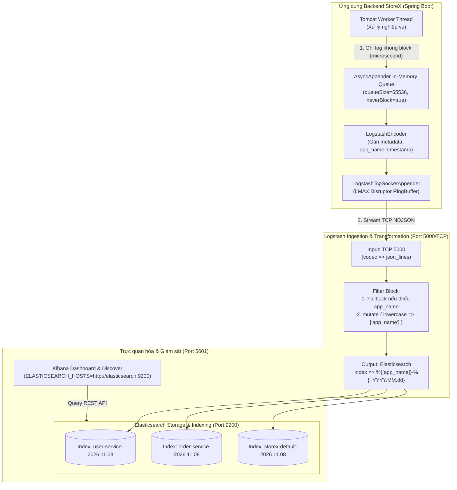

# SS17 - EFK/ELK Stack: Khởi tạo, Cấu hình Pipeline, Dynamic Indexing & Xử lý Nghẽn Tải Cao

Dự án thực hành chuyên sâu về bộ giải pháp quản lý tập trung và phân tích log **EFK/ELK Stack (Elasticsearch, Logstash/Fluentd, Kibana)** kết hợp với **Spring Boot**. Khóa học giải quyết 4 bài toán kinh điển trong môi trường DevOps/SRE: gỡ lỗi kết nối mạng, chuẩn hóa codec luồng dữ liệu JSON, phân loại index động theo microservice và chống sập hệ thống khi nghẽn tải hàng chục ngàn log/giây.

---

## 📋 Cấu trúc thư mục

```text
SS17/
├── bai1/
│   ├── docker-compose.yml                      ← Cụm Elasticsearch (port 9200) + Kibana (port 5601)
│   └── README.md                               ← Phân tích Port 9200 (REST) vs Port 9300 (Transport), fix unreachable
├── bai2/
│   ├── docker-compose.yml                      ← Môi trường EFK với Logstash tiếp nhận cổng 5000/TCP
│   ├── logstash/
│   │   └── pipeline/
│   │       └── logstash.conf                   ← Fix lỗi codec: dùng json_lines thay vì plain mặc định
│   └── README.md                               ← Phân tích NDJSON Stream framing, đối chiếu codec & test payload
├── bai3/
│   ├── docker-compose.yml                      ← Cụm EFK hỗ trợ dynamic routing đa dịch vụ
│   ├── logstash/
│   │   └── pipeline/
│   │       └── logstash.conf                   ← Dynamic Index: %{[app_name]}-%{+YYYY.MM.dd} + lowercase + fallback
│   └── README.md                               ← Phân tích Field Reference, quy tắc đặt tên Index ES & test indices
├── bai4/
│   ├── logback-spring.xml                      ← Cấu hình AsyncAppender (neverBlock=true, queueSize=65536) + TCP RingBuffer
│   ├── pom.xml                                 ← Cấu hình Maven Spring Boot + logstash-logback-encoder
│   └── README.md                               ← Phân tích TCP Backpressure, Thread Starvation & kiến trúc Kafka buffer
└── README.md                                   ← Báo cáo tổng hợp toàn bộ bài tập SS17
```

---

## 🎯 Tóm tắt kiến thức cốt lõi & Bẫy kỹ thuật

| Bài | Tên bài tập | Vấn đề ban đầu & Bẫy kỹ thuật | Giải pháp kỹ thuật chuẩn hóa |
|---|---|---|---|
| **Bài 1** | **Khởi tạo môi trường EFK với Docker Compose** | **Bẫy Port Transport (`9300`):** Cấu hình `ELASTICSEARCH_HOSTS=http://elasticsearch:9300`. Kibana là HTTP Client nhưng lại gửi request vào cổng nhị phân Transport nội bộ của ES, dẫn đến lỗi `Elasticsearch is unreachable` và `Kibana server is not ready yet` (HTTP 503). | Sửa thành **`http://elasticsearch:9200`** (cổng chuẩn HTTP REST API của ES). Expose cổng `9200:9200` và `5601:5601`, bổ sung `ES_JAVA_OPTS=-Xms512m -Xmx512m`, mạng bridge `efk-net` và healthcheck. |
| **Bài 2** | **Cấu hình Logstash nhận log từ Spring Boot** | **Bẫy Codec `plain` mặc định:** TCP input không khai báo codec nên mặc định dùng `plain`. Chuỗi JSON bị coi là raw string nhét vào trường `message`, không thể query/filter. Nếu dùng `codec => json` thì bị lỗi ngắt gói tin do TCP stream không có ranh giới document. | Đổi sang **`codec => json_lines`**. Thư viện `logstash-logback-encoder` gửi theo chuẩn **NDJSON** (kết thúc bằng ký tự `\n`). `json_lines` bóc tách từng dòng thành các JSON fields có cấu trúc độc lập trên Elasticsearch. |
| **Bài 3** | **Phân loại Log theo Index trên Elasticsearch** | **Bẫy Gộp chung Index & Tên Index chữ hoa:** Tất cả log của `user-service` và `order-service` bị tống chung vào `logstash-%{+YYYY.MM.dd}`, gây xung đột schema (mapping conflict) và khó phân quyền. Nếu đổi index chứa chữ hoa (`Order-Service`) thì Elasticsearch ném lỗi `InvalidIndexNameException`. | Đổi output thành **`index => "%{[app_name]}-%{+YYYY.MM.dd}"`**. Bổ sung filter **`mutate { lowercase => ["app_name"] }`** để đảm bảo tuân thủ quy tắc Elasticsearch và gán **fallback default** nếu log thiếu trường `app_name`. |
| **Bài 4** | **Phân tích và sửa lỗi Lost Log khi Logstash nghẽn** | **Bẫy TCP Backpressure & Thread Pool Starvation:** Ở tải 10.000 log/s đợt Sale, Logstash nghẽn khiến TCP Socket buffer đầy. Lời gọi `logger.info()` đồng bộ làm block toàn bộ 200 Tomcat Worker Threads, gây sập dây chuyền (Cascading Failure), trả về HTTP 504 Gateway Timeout. | Cấu hình **`AsyncAppender`** bọc ngoài TCP Appender: đặt **`neverBlock=true`** (drop log khi đầy hàng đợi để bảo vệ sống còn của app chính), nâng **`queueSize=65536`**, `discardingThreshold=20`. Kiến trúc Enterprise scale lớn sử dụng **Apache Kafka** làm Shock Absorber và bật **Persistent Queue (PQ)** trên Logstash. |

---

## 🏗️ Kiến trúc Pipeline End-to-End



---

## 🚀 Hướng dẫn khởi chạy & Kiểm thử nhanh

### Bài 1: Chạy cụm Elasticsearch & Kibana
```bash
cd SS17/bai1
docker-compose up -d

# Kiểm tra sức khỏe Elasticsearch
curl -X GET http://localhost:9200

# Kiểm tra trạng thái Kibana
curl -s http://localhost:5601/api/status

# Truy cập trình duyệt: http://localhost:5601
```

### Bài 2: Kiểm thử Logstash nhận JSON qua cổng 5000
```bash
cd SS17/bai2
docker-compose up -d

# Gửi log JSON qua PowerShell:
$client = New-Object System.Net.Sockets.TcpClient('localhost', 5000)
$stream = $client.GetStream()
$writer = New-Object System.IO.StreamWriter($stream, [System.Text.Encoding]::UTF8)
$writer.WriteLine('{"app_name":"storex","level":"INFO","userId":1001,"message":"Login successful"}')
$writer.Flush(); $client.Close()

# Kiểm tra document có cấu trúc trên Elasticsearch
curl -X GET "http://localhost:9200/storex-logs-*/_search?pretty"
```

### Bài 3: Kiểm thử Dynamic Routing Index theo từng Microservice
```bash
cd SS17/bai3
docker-compose up -d

# Bắn log của user-service và order-service qua PowerShell:
$client = New-Object System.Net.Sockets.TcpClient('localhost', 5000)
$stream = $client.GetStream()
$writer = New-Object System.IO.StreamWriter($stream, [System.Text.Encoding]::UTF8)
$writer.WriteLine('{"app_name":"user-service","level":"INFO","message":"User 101 updated"}')
$writer.WriteLine('{"app_name":"Order-Service","level":"INFO","message":"Order 555 paid"}')
$writer.Flush(); $client.Close()

# Kiểm tra danh sách index riêng biệt trên Elasticsearch
curl -X GET "http://localhost:9200/_cat/indices?v&s=index"
```

---

## 📤 Hướng dẫn nộp bài lên GitHub

Để đưa toàn bộ mã nguồn bài tập SS17 lên GitHub:

```bash
# 1. Kiểm tra trạng thái các tệp đã tạo
git status

# 2. Thêm thư mục SS17 vào staging
git add SS17/

# 3. Commit các thay đổi với thông điệp chuẩn mực
git commit -m "feat(ss17): hoan thanh 4 bai tap EFK stack, logstash pipeline, dynamic indexing va async logging"

# 4. Đẩy mã nguồn lên repository chính trên GitHub
git push origin main
```

Sau khi hoàn tất lệnh `git push`, sao chép đường link thư mục `SS17` hoặc link repository của bạn và dán vào form nộp bài trên Portal.
