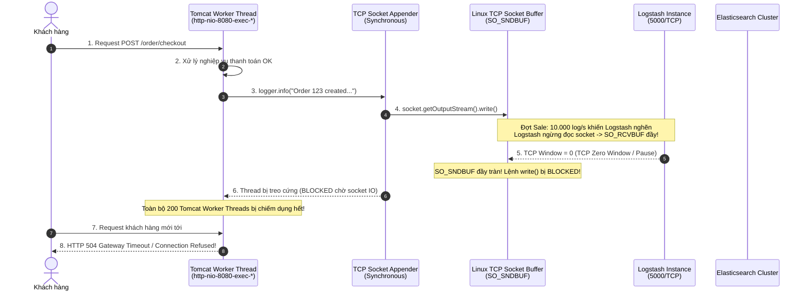
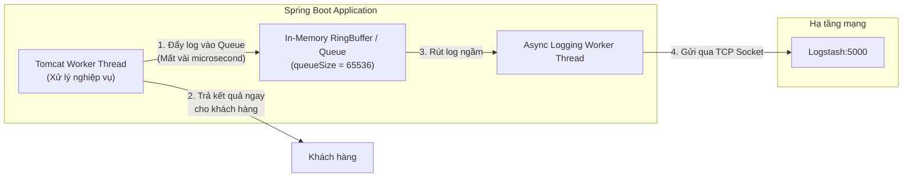
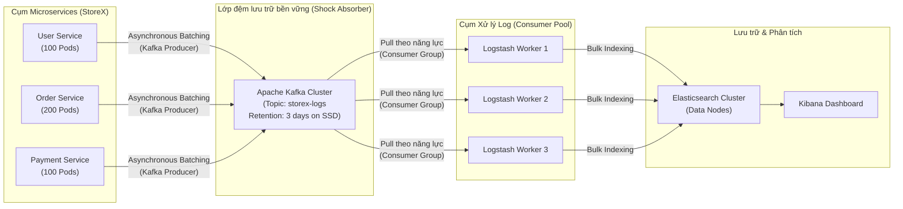

# Bài tập 4: Phân tích và sửa lỗi Lost Log khi Logstash nghẽn - Asynchronous Logging & Enterprise Buffer Architecture

## 1. Mục tiêu kiến thức
- Hiểu sâu bản chất hiện tượng **Nghẽn ngược (TCP Backpressure)** và **Cạn kiệt luồng (Thread Pool Starvation)** khi gửi log qua mạng theo cơ chế đồng bộ.
- Phân tích nguyên nhân gây sập dây chuyền (**Cascading Failure**) khiến hệ thống phụ trợ (Logging) làm chết đứng hệ thống nghiệp vụ chính (E-Commerce StoreX).
- Nắm vững kiến trúc và các tham số tối ưu hóa của **`AsyncAppender`** và **`LogstashTcpSocketAppender`** trong Logback/Spring Boot.
- Đánh giá chiến lược đánh đổi (**Trade-off Analysis**): Giữa **Tính sẵn sàng cao (High Availability)** và **Bảo toàn dữ liệu tuyệt đối (Zero Data Loss)**.
- Làm chủ kiến trúc đệm phân tán cấp Doanh nghiệp (**Enterprise Message Broker Buffer**) với **Apache Kafka** và **Logstash Persistent Queue (PQ)** khi xử lý tải đột biến từ 10.000+ log/giây.

---

## 2. Tình huống nghiệp vụ & Phân tích nguyên nhân lỗi

### 2.1. Tình huống
Vào sự kiện Siêu Sale 11/11, lưu lượng người dùng truy cập StoreX tăng gấp 30 lần bình thường, tạo ra đỉnh tải **10.000 dòng log/giây**.
Hệ thống Logstash bị quá tải CPU/RAM, xử lý không kịp khiến ứng dụng Spring Boot bị lỗi Timeout hàng loạt khi gửi log qua kết nối TCP. Toàn bộ website StoreX bị tê liệt, khách hàng không thể thêm hàng vào giỏ hay thanh toán, phát sinh lỗi HTTP 504 Gateway Timeout.

Đoạn cấu hình ban đầu trong `logback-spring.xml`:
```xml
<!-- CẤU HÌNH BAN ĐẦU BỊ LỖI -->
<appender name="LOGSTASH" class="net.logstash.logback.appender.LogstashTcpSocketAppender">
    <destination>logstash:5000</destination>
    <!-- LỖI CỐT LÕI: Ghi trực tiếp vào TCP Socket mà không qua hàng đợi bất đồng bộ -->
    <encoder class="net.logstash.logback.encoder.LogstashEncoder" />
</appender>
```

---

### 2.2. Phân tích chi tiết: Tại sao Appender TCP đồng bộ lại làm chết hệ thống chính?



#### Quá trình sập dây chuyền (Cascading Failure Step-by-Step):
1. **Luồng nghiệp vụ xử lý đồng bộ:** Khi code gọi `logger.info(...)`, lệnh này chạy trực tiếp trên luồng HTTP của Tomcat (ví dụ `http-nio-8080-exec-15`).
2. **Nghẽn tại Logstash & Elasticsearch:** Ở tải 10.000 log/s, Logstash bị quá tải CPU hoặc Elasticsearch gặp hiện tượng Full GC / IO Bottleneck khi flush đĩa, Logstash không kịp gọi lệnh `read()` trên Socket nhận.
3. **Kích hoạt TCP Flow Control (Zero Window):**
   - Bộ đệm nhận của OS phía Logstash (`SO_RCVBUF`) bị đầy tràn.
   - Giao thức TCP tự động gửi cờ báo `TCP Zero Window` sang phía máy chủ Spring Boot để yêu cầu tạm dừng truyền dữ liệu.
4. **Bộ đệm gửi đầy & Block luồng:**
   - Bộ đệm gửi (`SO_SNDBUF`) phía Spring Boot cũng bị lấp đầy chỉ sau vài phần trăm giây.
   - Phương thức ghi socket `write()` bị hệ điều hành chặn đứng (blocking).
5. **Cạn kiệt Thread Pool (Thread Pool Starvation):**
   - Máy chủ Tomcat mặc định cấu hình `server.tomcat.threads.max = 200`.
   - Cứ mỗi request hoàn thành logic nghiệp vụ nhảy vào dòng `logger.info()` thì đều bị treo tại chỗ.
   - Chỉ trong vòng **vài giây**, toàn bộ 200 worker threads đều rơi vào trạng thái `BLOCKED` hoặc `TIMED_WAITING`.
6. **Sập toàn bộ dịch vụ:**
   - Không còn luồng nào rảnh rỗi để tiếp nhận các request HTTP mới từ người dùng.
   - Hàng đợi `accept-count` của Tomcat đầy tràn $\rightarrow$ Hệ thống sập hoàn toàn dù CPU máy chủ Spring Boot có thể đang rất thấp!

> [!CAUTION]
> **Quy tắc vàng trong Kiến trúc Vận hành:** Hệ thống phụ trợ (Telemetry, Logging, Metrics) **tuyệt đối không bao giờ** được phép gây ảnh hưởng tiêu cực hoặc làm sập hệ thống nghiệp vụ phục vụ doanh thu của doanh nghiệp.

---

## 3. Giải pháp kỹ thuật chuẩn hóa

### 3.1. Cơ chế Asynchronous Logging với `AsyncAppender`
Giải pháp là tách rời hoàn toàn **Luồng xử lý nghiệp vụ (Application Thread)** khỏi **Luồng ghi I/O mạng (Logging Worker Thread)** thông qua một **Hàng đợi trong bộ nhớ (In-Memory Queue)**:



### 3.2. Phân tích chi tiết các tham số tối ưu hóa

| Tham số | Giá trị mặc định | Giá trị chuẩn hóa đợt Sale | Phân tích lý do kỹ thuật |
|---|---|---|---|
| **`queueSize`** | `256` | **`65536`** (hoặc `32768`) | Mặc định 256 chỉ đủ chứa log trong 0.025 giây ở tải 10.000 log/s! Cần tăng lên 65536 để hấp thụ các xung nhịp tải tăng đột biến (Spikes). |
| **`discardingThreshold`** | `20` (20%) | **`20`** (giữ nguyên) | Khi hàng đợi chỉ còn trống 20% dung lượng, hệ thống sẽ tự động vứt bỏ các log cấp thấp (`TRACE`, `DEBUG`, `INFO`) để ưu tiên giữ lại các log nguy cấp (`WARN`, `ERROR`). |
| **`neverBlock`** | `false` | **`true`** | **THAM SỐ QUAN TRỌNG NHẤT:** Khi hàng đợi đầy tràn, `neverBlock=true` sẽ drop log ngay lập tức thay vì bắt luồng HTTP của Tomcat phải đứng chờ. Ưu tiên giữ website sống sót! |
| **`includeCallerData`** | `false` | **`false`** | Tránh việc Logback phải quét StackTrace qua Reflection để tìm số dòng/tên class, giúp tiết kiệm 70% CPU cho việc log. |
| **`maxFlushTime`** | `1000` ms | **`5000`** ms | Thời gian cho phép xả nốt log trong queue khi container shutdown (Graceful Shutdown). |
| **`ringBufferSize`** | `8192` | **`32768`** | Buffer bên trong `LogstashTcpSocketAppender` (sử dụng LMAX Disruptor không khóa - Lock-free). |

### 3.3. File `logback-spring.xml` hoàn chỉnh

```xml
<?xml version="1.0" encoding="UTF-8"?>
<configuration>

    <springProperty scope="context" name="appName" source="spring.application.name" defaultValue="storex-backend"/>
    <property name="LOGSTASH_HOST" value="${LOGSTASH_HOST:-logstash}"/>
    <property name="LOGSTASH_PORT" value="${LOGSTASH_PORT:-5000}"/>

    <!-- 1. Console Appender phục vụ Debug cục bộ -->
    <appender name="CONSOLE" class="ch.qos.logback.core.ConsoleAppender">
        <encoder>
            <pattern>%d{yyyy-MM-dd HH:mm:ss.SSS} [%thread] %-5level %logger{36} - %msg%n</pattern>
        </encoder>
    </appender>

    <!-- 2. Logstash TCP Socket Appender (Gốc) -->
    <appender name="LOGSTASH_TCP" class="net.logstash.logback.appender.LogstashTcpSocketAppender">
        <destination>${LOGSTASH_HOST}:${LOGSTASH_PORT}</destination>
        
        <!-- Tinh chỉnh RingBuffer LMAX Disruptor và Socket buffer -->
        <ringBufferSize>32768</ringBufferSize>
        <reconnectionDelay>5 second</reconnectionDelay>
        <writeBufferSize>16384</writeBufferSize>
        
        <encoder class="net.logstash.logback.encoder.LogstashEncoder">
            <customFields>{"app_name":"${appName}"}</customFields>
            <includeCallerData>false</includeCallerData>
        </encoder>
    </appender>

    <!-- 3. AsyncAppender của Logback bọc ngoài Appender mạng -->
    <!-- ĐÂY LÀ GIẢI PHÁP CHỐNG NGHẼN CHO TOÀN BỘ WORKER THREAD CỦA ỨNG DỤNG -->
    <appender name="ASYNC_LOGSTASH" class="ch.qos.logback.classic.AsyncAppender">
        <appender-ref ref="LOGSTASH_TCP" />
        
        <!-- Nâng kích thước hàng đợi lên 65536 để đệm tải 10.000 log/s -->
        <queueSize>65536</queueSize>
        
        <!-- Drop TRACE, DEBUG, INFO khi hàng đợi đạt 80% để cứu WARN, ERROR -->
        <discardingThreshold>20</discardingThreshold>
        
        <!-- CHỐT CHẶN BẢO VỆ HỆ THỐNG: Drop log khi queue đầy, tuyệt đối KHÔNG block thread chính -->
        <neverBlock>true</neverBlock>
        
        <!-- Thời gian chờ xả queue khi tắt service (ms) -->
        <maxFlushTime>5000</maxFlushTime>
        
        <!-- Tắt lấy thông tin caller để tối ưu CPU -->
        <includeCallerData>false</includeCallerData>
    </appender>

    <!-- Áp dụng AsyncAppender cho Root Logger -->
    <root level="INFO">
        <appender-ref ref="CONSOLE" />
        <appender-ref ref="ASYNC_LOGSTASH" />
    </root>

</configuration>
```

---

## 4. Kiến trúc Enterprise toàn diện cho Tải Siêu Cao (10.000+ log/giây)

Dù `AsyncAppender` với `neverBlock=true` giúp ứng dụng Spring Boot không bị sập, nhưng nếu Logstash bị nghẽn trong thời gian dài, hiện tượng **Drop Log (Mất log)** vẫn sẽ xảy ra do hàng đợi RAM bị đầy.

Để đạt được cả 2 mục tiêu: **Hệ thống chạy mượt (High Availability)** VÀ **Không mất bất kỳ dòng log nào (Zero Data Loss)** ở quy mô hàng chục ngàn log/s, các tập đoàn công nghệ áp dụng kiến trúc chuẩn sau:



### Các thành phần mấu chốt của Kiến trúc Doanh nghiệp:

1. **Apache Kafka đóng vai trò "Bộ giảm xóc" (Shock Absorber):**
   - Các ứng dụng Spring Boot ghi log vào Kafka qua `kafka-clients` hoặc `logback-kafka-appender`.
   - Kafka có khả năng ghi tuần tự trên đĩa với thông lượng lên tới hàng triệu message/giây mà không tốn nhiều CPU.
   - Log được lưu bền vững (Persistent) trên đĩa trong 3-7 ngày, ngay cả khi toàn bộ Logstash bị sập thì log vẫn an toàn trong Kafka.

2. **Mô hình Kéo (Pull-based Model) của Logstash:**
   - Logstash chuyển từ chế độ bị động nhận (Push/TCP) sang chủ động kéo (Pull) từ Kafka Topic:
     ```ruby
     input {
       kafka {
         bootstrap_servers => "kafka1:9092,kafka2:9092"
         topics => ["storex-logs"]
         codec => json
         consumer_threads => 4
       }
     }
     ```
   - Logstash xử lý theo đúng năng lực của CPU/Elasticsearch, không bao giờ bị nghẽn ngược về phía ứng dụng backend.

3. **Bật Logstash Persistent Queue (PQ):**
   - Trong file cấu hình `logstash.yml`, kích hoạt:
     ```yaml
     queue.type: persisted
     path.queue: /usr/share/logstash/data/queue
     queue.max_bytes: 8gb
     queue.checkpoint.writes: 1024
     ```
   - Đảm bảo khi container Logstash bị mất điện đột ngột hoặc restart, các bản ghi log đang nằm trong pipeline của Logstash sẽ được phục hồi lại đầy đủ từ ổ cứng (At-least-once delivery).

---

## 5. Kết luận & Khuyến nghị vận hành Production
1. **Tuyệt đối không sử dụng TCP Appender đồng bộ** trực tiếp từ Backend tới Logstash trong môi trường Production.
2. Luôn bọc qua **`AsyncAppender`** với `neverBlock=true` và tăng `queueSize >= 32768` để bảo vệ ứng dụng nghiệp vụ trước rủi ro mạng.
3. Khi lưu lượng vượt ngưỡng 5.000 - 10.000 log/s, bắt buộc phải triển khai lớp Message Broker trung gian (**Apache Kafka / RabbitMQ**) và bật **Persistent Queue** trên Logstash.
